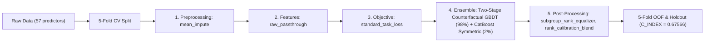

# CIBMTR - Equity in Post-HCT Survival Predictions

[-0A66C2?style=for-the-badge)](#how-this-pipeline-was-built)
[](#how-this-pipeline-was-built)
[](#verified-validation-benchmark)
[](#governance--production-guarantees)
[](https://www.kaggle.com/code/stefanoclss/cibmtr-equity-in-post-hct-survival-predictions)
[](https://www.kaggle.com/competitions/equity-post-HCT-survival-predictions)

> **Autonomous End-to-End Machine Learning Engineering by sovLoop**
> From raw tabular schema forensics to interpretable `preprocessing(df)` & `feature_engineering(df)` pipelines, Optuna-tuned multi-family GBDT ensembles, and zero-pickle production packaging—evolved step-by-step using **`qwen36-architect`**.

---

## Executive Overview

Predict `efs_time` (regression) across `57` structured predictors on `train.csv` accounting for right-censored event indicator `efs` under strict leak-free 5-fold out-of-fold validation to maximize `C_INDEX`.

<details>
<summary><strong>Dataset Schema & Variable Dictionary</strong></summary>

[Data Dictionary: data_dictionary.csv]
 - dri_score: Refined disease risk index: Categorical
 - psych_disturb: Psychiatric disturbance: Categorical
 - cyto_score: Cytogenetic score: Categorical
 - diabetes: Diabetes: Categorical
 - hla_match_c_high: Recipient / 1st donor allele level (high resolution) matching at HLA-C: Numerical
 - hla_high_res_8: Recipient / 1st donor allele-level (high resolution) matching at HLA-A,-B,-C,-DRB1: Numerical
 - tbi_status: TBI: Categorical
 - arrhythmia: Arrhythmia: Categorical
 - hla_low_res_6: Recipient / 1st donor antigen-level (low resolution) matching at HLA-A,-B,-DRB1: Numerical
 - graft_type: Graft type: Categorical
 - vent_hist: History of mechanical ventilation: Categorical
 - renal_issue: Renal, moderate / severe: Categorical
 - pulm_severe: Pulmonary, severe: Categorical
 - prim_disease_hct: Primary disease for HCT: Categorical
 - hla_high_res_6: Recipient / 1st donor allele-level (high resolution) matching at HLA-A,-B,-DRB1: Numerical
 - cmv_status: Donor/recipient CMV serostatus: Categorical
 - hla_high_res_10: Recipient / 1st donor allele-level (high resolution) matching at HLA-A,-B,-C,-DRB1,-DQB1: Numerical
 - hla_match_dqb1_high: Recipient / 1st donor allele level (high resolution) matching at HLA-DQB1: Numerical
 - tce_imm_match: T-cell epitope immunogenicity/diversity match: Categorical
 - hla_nmdp_6: Recipient / 1st donor matching at HLA-A(lo),-B(lo),-DRB1(hi): Numerical
 - hla_match_c_low: Recipient / 1st donor antigen level (low resolution) matching at HLA-C: Numerical
 - rituximab: Rituximab given in conditioning: Categorical
 - hla_match_drb1_low: Recipient / 1st donor antigen level (low resolution) matching at HLA-DRB1: Numerical
 - hla_match_dqb1_low: Recipient / 1st donor antigen level (low resolution) matching at HLA-DQB1: Numerical
 - prod_type: Product type: Categorical
 - cyto_score_detail: Cytogenetics for DRI (AML/MDS): Categorical
 - conditioning_intensity: Computed planned conditioning intensity: Categorical
 - ethnicity: Ethnicity: Categorical
 - year_hct: Year of HCT: Numerical
 - obesity: Obesity: Categorical
 - mrd_hct: MRD at time of HCT (AML/ALL): Categorical
 - in_vivo_tcd: In-vivo T-cell depletion (ATG/alemtuzumab): Categorical
 - tce_match: T-cell epitope matching: Categorical
 - hla_match_a_high: Recipient / 1st donor allele level (high resolution) matching at HLA-A: Numerical
 - hepatic_severe: Hepatic, moderate / severe: Categorical
 - donor_age: Donor age: Numerical
 - prior_tumor: Solid tumor, prior: Categorical
 - hla_match_b_low: Recipient / 1st donor antigen level (low resolution) matching at HLA-B: Numerical
 - peptic_ulcer: Peptic ulcer: Categorical
 - age_at_hct: Age at HCT: Numerical
 - hla_match_a_low: Recipient / 1st donor antigen level (low resolution) matching at HLA-A: Numerical
 - gvhd_proph: Planned GVHD prophylaxis: Categorical
 - rheum_issue: Rheumatologic: Categorical
 - sex_match: Donor/recipient sex match: Categorical
 - hla_match_b_high: Recipient / 1st donor allele level (high resolution) matching at HLA-B: Numerical
 - race_group: Race: Categorical
 - comorbidity_score: Sorror comorbidity score: Numerical
 - karnofsky_score: KPS at HCT: Numerical
 - hepatic_mild: Hepatic, mild: Categorical
 - tce_div_match: T-cell epitope matching: Categorical
 - donor_related: Related vs. unrelated donor: Categorical
 - melphalan_dose: Melphalan dose (mg/m^2): Categorical
 - hla_low_res_8: Recipient / 1st donor antigen-level (low resolution) matching at HLA-A,-B,-C,-DRB1: Numerical
 - cardiac: Cardiac: Categorical
 - hla_match_drb1_high: Recipient / 1st donor allele level (high resolution) matching at HLA-DRB1: Numerical
 - pulm_moderate: Pulmonary, moderate: Categorical
 - hla_low_res_10: Numerical
 - efs: Event-free survival: Categorical
 - efs_time: Time to event-free survival, months: Numerical

</details>

Production data science teams need pipelines that are not only accurate, but **readable, explainable, and maintainable**. Every transformation in this repository is organized by pipeline topology stage (`preprocessing`, `feature_engineering`, `objective`, `models`, `postprocess`) and validated incrementally via **sovLoop** (operating in private stealth mode).

---

## How This Pipeline Was Built

1. **Simple Baseline -> Gradual Verified Evolution**: Starting from a clean baseline, **sovLoop** (guided by `qwen36-architect`) evolved one stage at a time—adding explicit column hygiene, domain features, leak-free target formulation, and Optuna hyperparameter optimization.
2. **Strict Out-of-Fold Scientific Gatekeeping**: Candidate modifications to preprocessing, feature engineering, estimator hyperparameters, and post-processing were evaluated across **100% of 5-fold out-of-fold validation rows**. Any change that failed to improve CV was rejected.
3. **Atomic Single-Module Git Lineage**: After initial scaffolding, **each commit in this repository modifies strictly one atomic stage file** (`pipeline/models.py`, `pipeline/features.py`, `pipeline/preprocess.py`, `pipeline/objective.py`, or `pipeline/postprocess.py`). Inspect `git log -p` to audit every single lift.
4. **Single-Notebook End-to-End Reproducibility (Zero-Pickle / No Git LFS)**: Place raw tables in `data/` and run **`pipeline.ipynb`** top-to-bottom to reproduce visual EDA (`eda_pipeline.py`), K-Fold LightGBM/Optuna training (`training_pipeline.py` -> `artifacts/model_artifact.json`), and pure artifact holdout inferencing (`inference_pipeline.py` -> `submission.csv`).

---

## Verified Validation Benchmark

| Benchmark Dimension | Verified Result |
| :--- | :--- |
| **Challenge / Dataset** | **CIBMTR - Equity in Post-HCT Survival Predictions** (`train.csv`) |
| **Target Variable (`y`)** | `efs_time` (`regression`) |
| **Evaluation KPI** | `C_INDEX` (Higher is better) |
| **Baseline 5-Fold OOF Score** | `0.60863` |
| **Champion 5-Fold OOF Score** | **`0.67566`** (`+0.06704` verified lift vs. baseline) |
| **Cross-Fold Stability (Std. Dev.)** | `±0.00403` across `5` strict folds |
| **Synthesis LLM** | `qwen36-architect` (via **sovLoop**) |

---

## Individual Model Benchmarks vs. Unrestricted Ensemble

Every individual model inside the unrestricted ensemble is benchmarked independently for standalone validation accuracy, training time, and inference latency—so production engineering teams can either deploy the **full unrestricted SOTA ensemble** or select the **fastest / best solo model** (`SELECTED_MODEL_KEY`) for strict SLA budgets:

| Model Family (`key`) | Standalone Val Score | Mean Fold Fit | Mean Fold Inference | Ensemble Weight | Deployment Role |
| :--- | :--- | :--- | :--- | :--- | :--- |
| **Two-Stage Counterfactual GBDT** (`two_stage`) | `0.67364 ± 0.00413` | `27599.8 ms` | `538.44 ms` | `98.1%` | `Best Solo Accuracy` |
| **CatBoost Symmetric** (`catboost`) | `0.65738 ± 0.00281` | `6066.0 ms` | `135.33 ms` | `1.9%` | `Active Ensemble Member` |
| **Optuna LightGBM** (`lgbm`) | `0.65645 ± 0.00250` | `2661.2 ms` | `62.03 ms` | `0.0%` | `Standby Candidate` |
| **Optuna XGBoost** (`xgb`) | `0.65484 ± 0.00399` | `3375.5 ms` | `31.29 ms` | `0.0%` | `Fastest Low-Latency` |

---

## Autonomous Build Ledger (Commit-by-Commit Scientific Progression)

Every row below corresponds to a verified out-of-fold promotion recorded as an **isolated single-module commit** in `git log`:

| Iteration | Module Evolved | Active Synthesis Operations | 5-Fold OOF `C_INDEX` | Lift | Engineering Rationale |
| :--- | :--- | :--- | :--- | :--- | :--- |
| **Gen 0** | `scaffold` | Baseline initialization | `0.60863` | `baseline` | Deterministic 5-fold leak-free baseline anchor |
| **Gen 1** | `pipeline/models.py` | `two_stage_counterfactual_gbdt`, `lgbm_optuna_tuned`, `catboost_tuned`, `xgb_optuna_tuned` | `0.67564` | `+0.06701` | Fast Multi-Family Blend (Two-Stage + Optuna-LightGBM + CatBoost + XGBoost) — Combines diverse `<60s/fold` GBDT & counterfactual families during core... |
| **Gen 2** | `pipeline/postprocess.py` | `subgroup_rank_equalizer`, `rank_calibration_blend` | `0.67566` | `+0.00003` | Subgroup Rank-Variance Equalization + Rank-Gauss Calibration — Stabilizes inter-cohort score spread to reduce subgroup metric dispersion without... |

---

## Modular Architecture & Repository Layout



| Deliverable | Role in Production Workflow |
| :--- | :--- |
| **`pipeline.ipynb`** | **Primary Topology Walkthrough Notebook**: explains every stage with visual charts and reproduces EDA, K-Fold training, and holdout scoring. |
| `eda.ipynb` / `eda_pipeline.py` | Schema diagnostics, missingness bar charts, and target distribution plots via `pipeline/eda.py`. |
| `train.ipynb` / `training_pipeline.py` | Leak-free K-Fold LightGBM + Optuna CV orchestrator exporting zero-pickle `artifacts/model_artifact.json` + `fold_*.lgb`. |
| `inference.ipynb` / `inference_pipeline.py` | Pure artifact-driven holdout scoring (`--artifact artifacts/model_artifact.json`) with zero re-training. |
| `pipeline/*.py` | Readable stage modules (`preprocessing(df)`, `feature_engineering(df)`, `models.py`) evolved one file per commit. |

---

## Governance & Production Guarantees

- **100% Validation Fold Integrity**: Imputation statistics, IQR bounds, Optuna inner splits, and target transforms fit strictly inside training folds.
- **Zero-Pickle Security (`CWE-502`)**: Models serialize to human-auditable LightGBM text/JSON (`fold_*.lgb`, `model_artifact.json`) — zero unsafe `.pkl` binaries.
- **Data-Scientist Readability**: Explicit column-by-column `pandas` transformations that any engineer can inspect, explain to stakeholders, and extend.

---

## Quickstart (1-Notebook Reproduction & CLI)

```bash
pip install -r requirements.txt

# Option A — Reproduce Training + Inferencing in ONE Notebook
jupyter execute pipeline.ipynb

# Option B — Modular CLI Orchestrators
python eda_pipeline.py --input data/train.csv
python training_pipeline.py --train data/train.csv --artifact-out artifacts/model_artifact.json --oof-out oof_predictions.csv
python inference_pipeline.py --artifact artifacts/model_artifact.json --test data/test.csv --output submission.csv
```

---

## Enterprise Pilots, Advisory & Executive Inquiries

> [!IMPORTANT]
> **Interested in deploying autonomous ML synthesis on your organization's proprietary tabular, risk, clinical, or forecasting data?**  
> **sovLoop** (stealth mode) accelerates production data science teams with transparent, audit-ready Python pipelines and zero vendor lock-in.

- **Architect & Creator**: **Stefano Claes**
- **Email**: [stefanoclaes@hotmail.com](mailto:stefanoclaes@hotmail.com)
- **LinkedIn**: [https://www.linkedin.com/in/stefano-claes-266435140/](https://www.linkedin.com/in/stefano-claes-266435140/)
